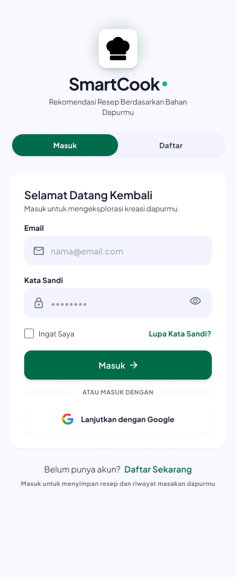
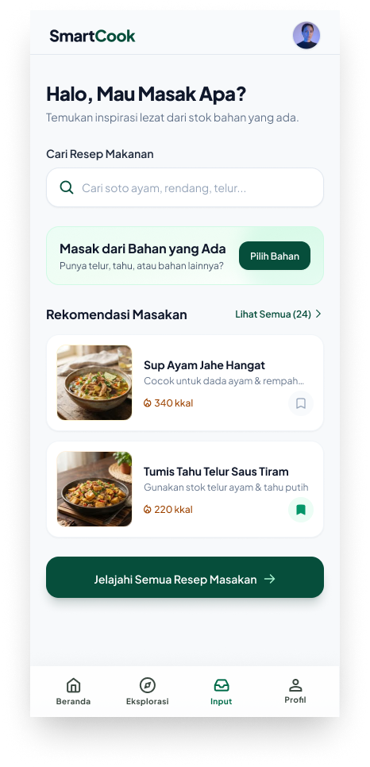
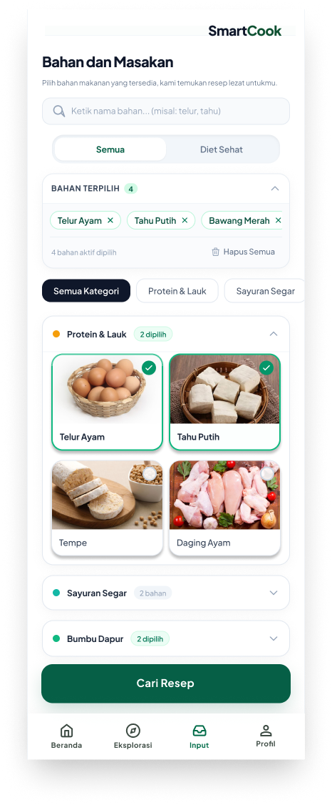

<div align="center">

# SmartCook

**Aplikasi rekomendasi resep masakan berdasarkan bahan yang kamu punya di dapur**

<!-- [](https://flutter.dev)
[](https://dart.dev)
[](https://riverpod.dev)
[](https://flutter.dev) -->

*Project Based Learning (PBL) — Semester 5*

</div>

---

## Tentang Aplikasi

**SmartCook** adalah aplikasi mobile berbasis Flutter yang membantu pengguna menemukan resep masakan berdasarkan bahan-bahan yang tersedia di dapur mereka. Cukup pilih bahan yang kamu punya, SmartCook akan merekomendasikan resep yang bisa dibuat, lengkap dengan informasi kalori, estimasi waktu memasak, dan panduan langkah demi langkah.

> Tidak perlu bingung mau masak apa. SmartCook yang cariin resepnya untukmu!

### Tujuan Aplikasi

- **Mengurangi food waste**  memanfaatkan bahan sisa di kulkas sebelum kadaluarsa
- **Memudahkan meal planning** menemukan masakan lezat dari bahan yang ada
- **Mendukung gaya hidup sehat** menyediakan info kalori dan filter menu diet
- **Meningkatkan keterampilan memasak** panduan langkah masak yang terstruktur

---

##  Fitur Utama

| Fitur | Deskripsi |
|-------|-----------|
|  **Beranda** | Dashboard utama dengan rekomendasi masakan & pencarian resep |
|  **Input Bahan** | Pilih bahan berdasarkan kategori (Protein, Sayuran, Bumbu) dengan visual kartu berfoto |
|  **Rekomendasi Resep** | Resep yang dicocokkan berdasarkan bahan terpilih + persentase kecocokan |
|  **Eksplorasi** | Katalog seluruh resep tanpa batasan bahan *(coming soon)* |
|  **Profil & Kesehatan** | Profil pengguna, IMT, target kalori harian, dan resep tersimpan |
|  **Autentikasi** | Login & registrasi akun dengan UI tab-pill yang smooth |

---

<!-- ## Screenshot

<table>
  <tr>
    <td align="center">
      <br/>
      <b>Login & Registrasi</b>
    </td>
    <td align="center">
      <br/>
      <b>Beranda</b>
    </td>
    <td align="center">
      <br/>
      <b>Input Bahan</b>
    </td>
  </tr>
  <tr>
    <td align="center">
      <br/>
      <b>Rekomendasi Resep</b>
    </td>
    <td align="center">
      <br/>
      <b>Profil & Kesehatan</b>
    </td>
    <td align="center">
      <br/>
      <b> Eksplorasi Resep</b>
    </td>
  </tr>
</table>

--- -->

##  Alur Penggunaan

```
Login / Daftar Akun
        │
        ▼
    Beranda
   ┌──────────────────────┐
   │ • Cari resep by nama │
   │ • Lihat rekomendasi  │
   └──────────────────────┘
        │
        ▼
    Input Bahan
   ┌──────────────────────────────────────┐
   │ • Pilih kategori: Protein / Sayuran  │
   │   / Bumbu Dapur                      │
   │ • Filter "Diet Sehat"                │
   │ • Cari bahan via search              │
   └──────────────────────────────────────┘
        │
        ▼
    Rekomendasi Resep
   ┌────────────────────────────────────┐
   │ • Resep diurutkan by % kecocokan   │
   │ • Info kalori per sajian           │
   │ • Notifikasi bahan yang kurang     │
   │ • Panduan masak step-by-step       │
   └────────────────────────────────────┘
```

---

##  Struktur Proyek

```
lib/
├── core/
│   ├── theme/
│   │   ├── app_colors.dart        # Palet warna SmartCook
│   │   ├── app_text_styles.dart   # Typography global
│   │   └── app_theme.dart         # ThemeData Flutter
│   └── widgets/
│       ├── app_button.dart        # Tombol reusable (primary, outline)
│       ├── app_text_field.dart    # Input field kustom
│       ├── app_bottom_nav.dart    # Bottom navigation bar
│       ├── recipe_card.dart       # Kartu resep reusable
│       ├── ingredient_chip.dart   # Chip bahan makanan
│       └── or_divider.dart        # Divider "atau"
└── presentation/
    ├── auth/                      # Login & Registrasi
    ├── home/                      # Tab Beranda
    ├── input_bahan/               # Tab Input Bahan
    ├── recommendation/            # Halaman Rekomendasi Resep
    ├── explore/                   # Tab Eksplorasi
    ├── profile/                   # Tab Profil
    └── shell/                     # Main navigation shell
```

---

## Cara Menjalankan

### Prasyarat
- Flutter SDK `^3.13.2` sudah terinstall
- Android Studio / VS Code dengan Flutter extension
- Emulator Android / iOS atau device fisik

### Langkah-langkah

```bash
# 1. Clone repository
git clone <url-repo-ini>
cd PBL-SmartCook

# 2. Install dependencies
flutter pub get

# 3. Jalankan aplikasi
flutter run
```

### Build APK (Android)

```bash
flutter build apk --release
```

---

##  Dependencies

```yaml
dependencies:
  flutter_riverpod: ^3.4.3   # State management
  google_fonts: ^9.0.0        # Font Nunito / Inter
  shared_preferences: ^2.5.6  # Penyimpanan lokal
  intl: ^0.20.3               # Format angka & tanggal
```

---

##  Tim Pengembang


| Nama | NIM |
|-------|-----------|
|  Adi Luhung |244107020088|
|  Angel Chelssa Leoniy E. P.|244107020202|
|  Febryan Akhmad Taajuddin |244107020180|
|  Muhammad Aryatama M. |244107020028|
|  Nadya Aurora Gebi Agista |244107020034|


<div align="center">


</div>
